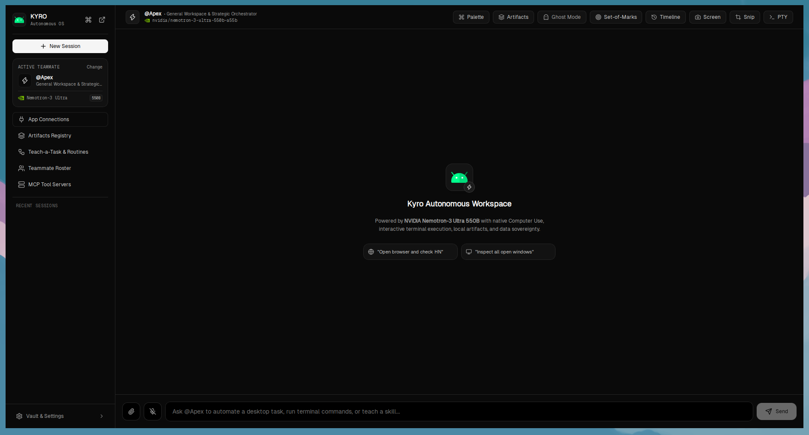
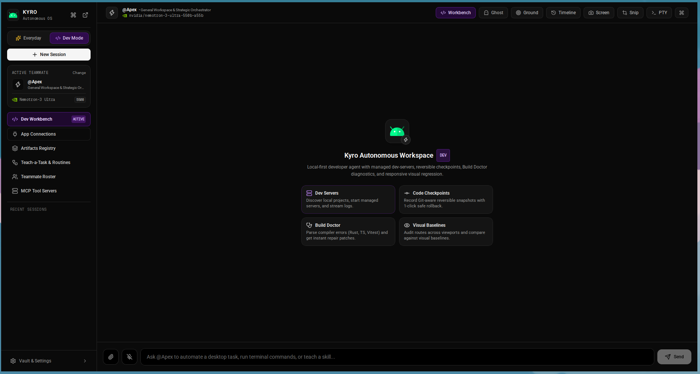
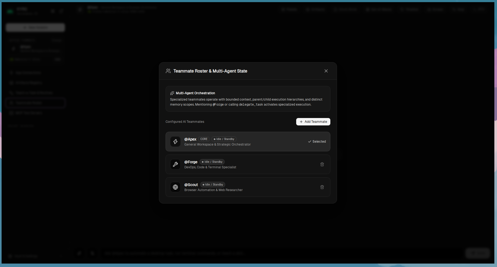
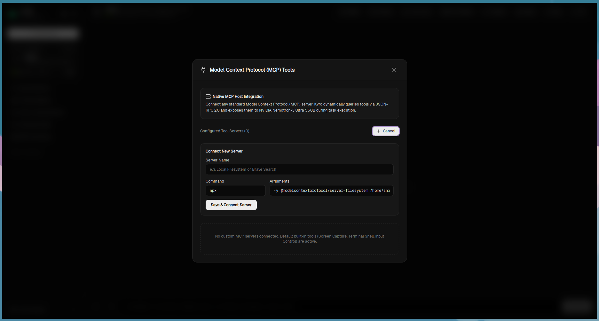
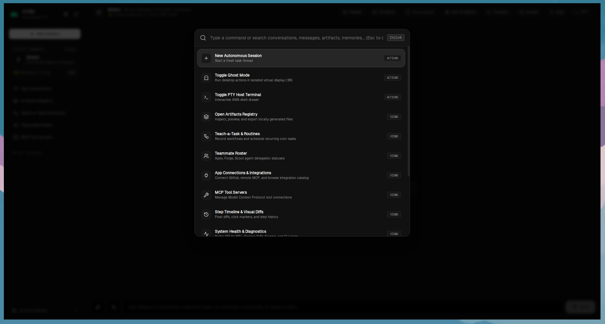
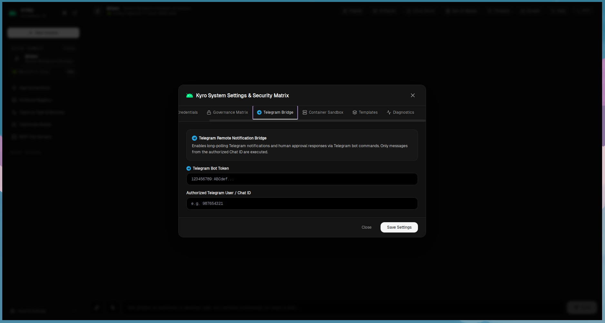
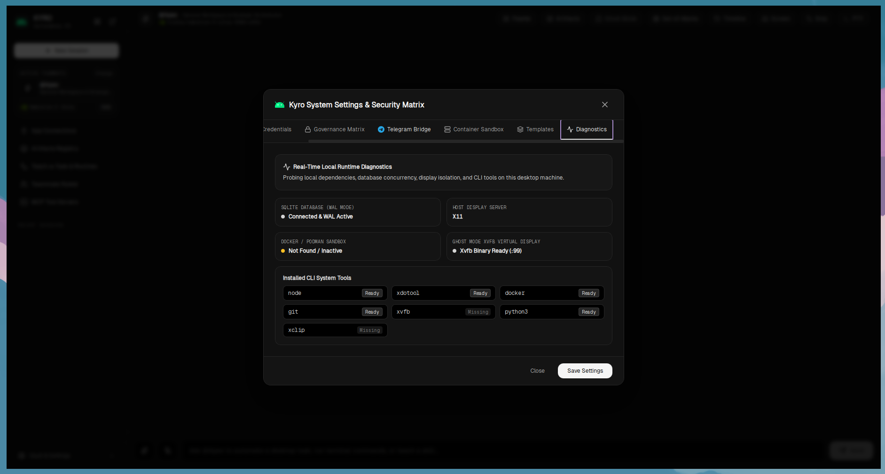
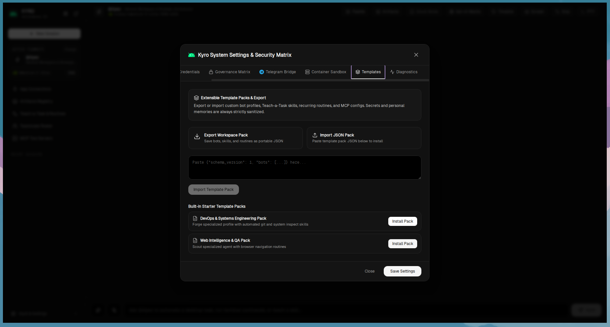
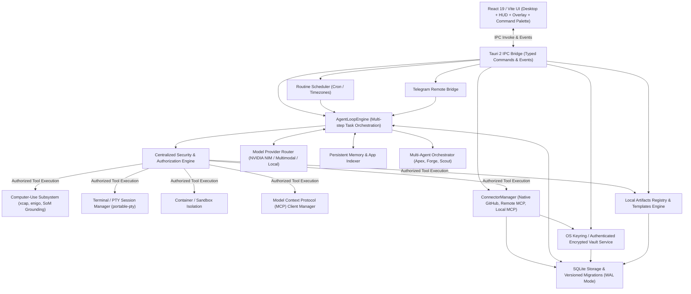

<p align="center">
  
</p>

<h1 align="center">Kyro</h1>

<p align="center">
  <strong>Local-First Autonomous Desktop AI Agent</strong><br />
  Built with Tauri v2, Rust & React 19.
</p>

<p align="center">
  <a href="https://github.com/eshanized/Kyro/actions/workflows/ci.yml"></a>
  <a href="https://github.com/eshanized/Kyro/discussions"></a>
  <a href="LICENSE"></a>
  <a href="https://tauri.app"></a>
  <a href="https://www.rust-lang.org/"></a>
  <a href="https://react.dev"></a>
  <a href="https://www.typescriptlang.org/"></a>
  <a href="#-zero-trust-security--privacy"></a>
  <a href="CONTRIBUTING.md"></a>
</p>

---

## 🌟 Overview

**Kyro** is a high-performance, local-first autonomous desktop AI agent that bridges natural language reasoning with real computer interaction. Unlike web-wrapped wrappers or cloud-dependent bots, Kyro runs a multi-threaded Rust native core with Tauri v2 and React 19, delivering zero-latency screen understanding, browser automation, terminal execution, and secure Model Context Protocol (MCP) integrations.

Kyro is built with a **Zero-Trust Security Model**: all conversations, embeddings, task histories, and artifacts stay strictly on your local disk in SQLite (WAL mode). API keys and credentials are encrypted using your Operating System Keyring (`Vault`), and dangerous actions require argument-aware authorization and human-in-the-loop verification.

---

## 📸 Visual Showcase

<div align="center">
  <h3>Everyday Mode & Interactive Assistant</h3>
  
</div>

<br />

<div align="center">
  <h3>Developer Workbench & Managed Dev Servers</h3>
  
</div>

<br />

<details>
<summary><strong>🔍 Click to view more features and interface previews</strong></summary>
<br />

| Safe Reversible File Organizer | Local-First Document Assistant |
|:---:|:---:|
|  |  |
| *Categorization rules & SHA-256 duplicate detection* | *Text/PDF parsing, date extraction, and side-by-side diffing* |

| Multimodal Screen Explainer | Teach-a-Task & Routine Scheduler |
|:---:|:---:|
|  |  |
| *Visual fact extraction, inferences, and 1-click actions* | *Demonstration recorder with cron & interval scheduling* |

| Connections & MCP Integration Center | Multi-Agent Worktree Workspace |
|:---:|:---:|
|  |  |
| *Model Context Protocol, OAuth PKCE, and token isolation* | *Specialist agents (Apex, Forge, Scout) with isolated git worktrees* |

</details>

---

## ✨ Key Features

### 🖥️ Dual Experience Modes
- **Everyday Mode**: Intuitive natural language workflows for non-developers:
  - **File Organizer**: Reversible file organization, collision handling, and SHA-256 deduplication.
  - **Document Assistant**: In-depth local PDF and plaintext parser with date/action item extraction and privacy disclosures.
  - **Screen Explainer**: Multimodal visual grounding with grounded 1-click prompt triggers.
- **Dev Workbench**: Specialized tools for software engineers:
  - **Projects & Dev Servers**: Auto-discovery of local projects, port status detection, and managed process lifecycles.
  - **Code Checkpoints & Diffs**: Instant git-aware snapshots, working tree clean checks, and rollback safety.
  - **Build Doctor**: Automated diagnostic triage for build failures, dependency issues, and syntax errors.
  - **UI Audit & Visual Regression**: Visual defect detection with multi-viewport baselines (Desktop, Tablet, Mobile).
  - **Multi-Agent Workspace**: Isolated Git worktree execution for autonomous teammates (**Apex**, **Forge**, **Scout**).

### 🔒 Zero-Trust Security & Privacy
- **100% Local-First Storage**: SQLite with WAL mode stores chat histories, memories, and task traces on your machine.
- **OS Keyring Vault**: API keys and OAuth tokens are stored in the OS credential store (macOS Keychain, Linux Secret Service, Windows Credential Manager) with AES-256-GCM authenticated fallback.
- **Argument-Aware Shell Governance**: Shell commands are lexically parsed into exact `argv` tokens; command injection and unverified metacharacters are rejected.
- **Human-in-the-Loop Takeover**: Automatic detection of sensitive checkpoints (2FA prompts, password inputs, CAPTCHA) with smooth interactive user takeover.
- **Secret Redaction**: Exported routines, templates, and IPC event payloads automatically redact sensitive credentials.

### 👁️ Computer-Use & Visual Grounding
- **Set-of-Marks (SoM) Grounding**: Precise visual tagging and coordinate targeting.
- **Native Input Synthesis**: Low-level mouse and keyboard emulation via `enigo`.
- **Browser Automation**: High-fidelity, provider-neutral browser automation supporting Firefox (native WebDriver BiDi) and Chromium-family browsers (Google Chrome, Chromium, Brave, Microsoft Edge, Vivaldi, Opera via CDP) with origin-scoping and strict non-substitution hierarchy.
- **Interactive Heads-Up Display (HUD)**: Compact floating snipping window (`Ctrl+K` instant search, region selector).

### 🧩 Connectors & Model Context Protocol (MCP)
- Full client implementation of the **Model Context Protocol (MCP)** (stdio, HTTP JSON-RPC 2.0, and SSE transports).
- Native **GitHub Connector** and **Google Connector** (Gmail & Google Calendar) with secure PKCE OAuth 2.0, single-flight token refresh, RFC 2822 header injection defenses, and RFC 2047 MIME encoding.
- Support for custom local stdio tools and remote SSE/HTTP MCP endpoints.
- Per-action governance policy management (Allow, Ask Always, Deny).

### ⏰ Teach-a-Task & Remote Notification Bridge
- Record user demonstrations and convert them into reusable, parameterized skills.
- Cron and interval scheduler with timezone awareness and concurrency overlap guards.
- **Telegram Bridge**: Secure bidirectional notifications and mobile task triggering.

---

## 🏗️ System Architecture



For in-depth architectural specifications:
- [Runtime Overview Specification](docs/architecture/runtime-overview.md)
- [Security Boundaries & Threat Model](docs/architecture/security-boundaries.md)
- [Connector System & Remote MCP Architecture](docs/architecture/connector-system.md)
- [Feature Implementation Matrix](docs/implementation/feature-matrix.md)

---

## ⚡ Quick Install & Uninstall (via curl)

Install the latest release of Kyro directly into `~/.local/bin` (no root required) or `/usr/local/bin` (if run as root):

```bash
curl -fsSL https://raw.githubusercontent.com/eshanized/Kyro/master/install.sh | bash
```

Custom installation directory (e.g. `/usr/local`):
```bash
curl -fsSL https://raw.githubusercontent.com/eshanized/Kyro/master/install.sh | bash -s -- --prefix /usr/local
```

To uninstall Kyro anytime:
```bash
curl -fsSL https://raw.githubusercontent.com/eshanized/Kyro/master/uninstall.sh | bash
```

To purge all local configuration, databases, and checkpoints upon uninstallation:
```bash
curl -fsSL https://raw.githubusercontent.com/eshanized/Kyro/master/uninstall.sh | bash -s -- --purge
```

---

## 📥 Prebuilt Linux Distribution Packages

Prebuilt packages for every major Linux distribution family are published under each [GitHub Release](https://github.com/eshanized/Kyro/releases):

| Distribution / Environment | Package Format | Quick Install Command |
|:---|:---:|:---|
| **Ubuntu, Debian, Pop!_OS, Linux Mint, Kali** | `.deb` | `sudo apt install ./Kyro_0.1.2_amd64.deb` |
| **Fedora, RHEL, CentOS Stream, Rocky, Alma** | `.rpm` | `sudo dnf install ./Kyro-0.1.2-1.x86_64.rpm` |
| **openSUSE (Leap / Tumbleweed)** | `.rpm` | `sudo zypper install ./Kyro-0.1.2-1.x86_64.rpm` |
| **Arch Linux, Manjaro, EndeavourOS, SteamOS** | `.pkg.tar.zst` | `sudo pacman -U kyro-0.1.2-1-x86_64.pkg.tar.zst` |
| **Universal Linux (Standalone / Zero Install)** | `.AppImage` | `chmod +x Kyro_0.1.2_amd64.AppImage && ./Kyro_0.1.2_amd64.AppImage` |
| **Portable Linux Archive (Custom Prefix)** | `.tar.gz` | `tar -xzf kyro-0.1.2-linux-x86_64.tar.gz && ./kyro-0.1.2-linux-x86_64/install.sh` |

Verify asset integrity with `sha256sum -c SHA256SUMS.txt`.

---

## 🚀 Building from Source

### 1. Prerequisites

Ensure your development environment meets the following requirements:

- **Node.js**: `>= 20.x` and `npm`
- **Rust**: `>= 1.75.0` (`cargo`, `rustc`)
- **System Dependencies**:
  - **Ubuntu / Debian**:
    ```bash
    sudo apt-get update && sudo apt-get install -y \
      libwebkit2gtk-4.1-dev \
      build-essential \
      curl \
      wget \
      file \
      libxdo-dev \
      libssl-dev \
      libayatana-appindicator3-dev \
      librsvg2-dev \
      xvfb
    ```
  - **macOS**:
    ```bash
    xcode-select --install
    ```
  - **Windows**:
    - [Microsoft C++ Build Tools](https://visualstudio.microsoft.com/visual-cpp-build-tools/)
    - [WebView2 Runtime](https://developer.microsoft.com/en-us/microsoft-edge/webview2/)

### 2. Installation

Clone the repository and install Node dependencies:

```bash
git clone https://github.com/eshanized/Kyro.git
cd Kyro
npm install
```

### 3. Running in Development

Kyro includes a complete Makefile for common workflows:

```bash
# Run full desktop app (Vite frontend + Rust native backend)
make dev

# Run Vite frontend in browser (http://localhost:1420)
make dev-ui

# Run full desktop app with verbose debug logging
make dev-debug

# Run headless under virtual X11 framebuffer (Linux / CI)
make dev-headless
```

### 4. Configuration

Configure model credentials in **Settings** within the Kyro desktop application, or copy `.env.example`:

```bash
cp .env.example .env
```

Keys configured in UI Settings are encrypted inside your OS Keyring and will never be committed or written in plaintext.

---

## 🛠️ Verification & Testing

Kyro has strict test coverage across unit, integration, and security layers (over 310 backend Rust tests and 268 frontend Vitest tests across 33 test suites, achieving &ge; 95% frontend coverage and 580+ total automated tests):

```bash
# Run the complete end-to-end verification pipeline:
make verify
```

This single command runs:
1. `make fmt-check` — Rust code formatting validation (`rustfmt`)
2. `make clippy` — Rust Clippy linter with zero warnings (`-D warnings`)
3. `make test` — All Rust unit, integration, and security regression tests
4. `make test-ui` — Frontend Vitest suite and TypeScript compiler check (`tsc --noEmit`)
5. `make build-ui` — Production frontend bundle build

---

## 📦 Building for Production

To build optimized release binaries and desktop bundles:

```bash
# Build production frontend and release desktop binary
make build

# Build platform installers (.deb, .AppImage, .dmg, .msi)
make tauri-build
# or: npm run tauri build
```

Installers will be generated in `libkyro/target/release/bundle/`.

---

## 📁 Repository Structure

```
Kyro/
├── assets/                  # High-resolution screenshots and brand assets
│   ├── logo.svg
│   └── screenshot_*.png
├── docs/                    # Architectural and implementation specifications
│   ├── architecture/        # Runtime, security, and connector specifications
│   └── implementation/      # Feature matrices and remediation records
├── kyroui/                  # React 19 + TypeScript + Tailwind frontend
│   ├── components/          # Modals (Workbench, Organizer, Assistant, Explainer, etc.)
│   ├── hud/                 # Floating HUD and snipper overlays
│   ├── test/                # Vitest frontend test suites
│   ├── types/               # TypeScript domain models and IPC contracts
│   └── App.tsx              # Main dual-mode application shell
├── libkyro/                 # Native Rust backend (Tauri v2)
│   ├── src/                 # Engine, governance, computer_use, connectors, storage
│   ├── tests/               # Integration, security, and UI audit test suites
│   ├── tauri.conf.json      # Tauri v2 desktop window & permissions configuration
│   └── Cargo.toml           # Rust package manifest
├── .github/                 # GitHub Actions CI/CD workflows and issue templates
│   ├── workflows/           # CI and Release multi-platform workflows
│   ├── ISSUE_TEMPLATE/      # Bug report and feature request templates
│   └── PULL_REQUEST_TEMPLATE.md
├── Makefile                 # Unified development, testing, and build automation
├── package.json             # Frontend dependencies and scripts
├── tailwind.config.js       # Tailwind CSS design system configuration
└── vite.config.ts           # Vite build and bundling configuration
```

---

## 🤝 Contributing

Contributions are welcome and appreciated! Please see [CONTRIBUTING.md](CONTRIBUTING.md) for step-by-step setup instructions, commit conventions, and pull request guidelines.

Please review our [Code of Conduct](CODE_OF_CONDUCT.md) before participating.

---

## 🛡️ Security

Security is foundational to Kyro. If you discover a vulnerability or security flaw, please review our [Security Policy](SECURITY.md) and report it privately to [m.eshanized@gmail.com](mailto:m.eshanized@gmail.com) rather than opening a public issue.

---

## 📄 License

Kyro is licensed under the [MIT License](LICENSE).
Copyright &copy; 2026 Eshan Roy and Kyro Contributors.
