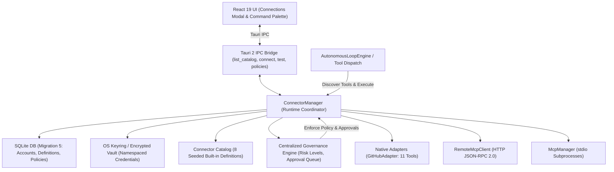

# Kyro App Connector System Architecture

## 1. Overview

Kyro's App Connector System provides a secure, local-first bridge between autonomous agent tasks and external third-party services and tool protocols. It unifies three distinct integration paradigms under a single runtime, catalog, and governance engine:

1. **Type A: Native API Connectors** — Provider-specific Rust adapters communicating with REST/GraphQL APIs (reference implementation: GitHub).
2. **Type B: Remote MCP Connectors** — Model Context Protocol endpoints reachable via HTTP JSON-RPC 2.0.
3. **Type C: Local MCP Connectors** — Subprocess stdio-based MCP servers managed locally.



---

## 2. Integration Types

### 2.1 Type A: Native API Connectors
Native connectors implement the `NativeConnectorAdapter` trait:
```rust
#[async_trait]
pub trait NativeConnectorAdapter: Send + Sync {
    fn connector_id(&self) -> &str;
    async fn discover_tools(&self, account: &ConnectedAccountRecord) -> Vec<ToolDefinition>;
    async fn execute_tool(
        &self,
        account: &ConnectedAccountRecord,
        vault: &Arc<Vault>,
        tool_name: &str,
        args: &serde_json::Value,
    ) -> Result<String, String>;
    async fn test_connection(
        &self,
        account: &ConnectedAccountRecord,
        vault: &Arc<Vault>,
    ) -> Result<String, String>;
}
```

#### Reference Implementation 1: `GitHubAdapter`
- **Read Tools (Safe, Scoped)**:
  - `github_get_user`: Retrieve authenticated user profile.
  - `github_list_repositories`: List repositories accessible to account.
  - `github_get_repository`: Get detailed repository metadata.
  - `github_list_issues`: List issues filtered by state/creator.
  - `github_get_issue`: Get issue conversation and comments.
  - `github_list_pull_requests`: List pull requests by state/branch.
  - `github_get_pull_request`: Inspect PR details and diff metadata.
  - `github_list_workflow_runs`: Inspect CI/CD GitHub Actions runs.
  - `github_get_workflow_run_jobs`: Inspect specific workflow run job steps and failure logs.
- **Write Tools (Moderate Risk, Require Approval)**:
  - `github_create_issue`: Create a new issue in a repository.
  - `github_add_issue_comment`: Add a comment to an issue or pull request.
- **Security & Reliability Controls**:
  - Response payload size truncation: bounded at 256 KB to protect LLM context windows.
  - Bounded timeouts (15 seconds) and retry-after header handling.
  - Informative status code mapping (401 Unauthorized, 403 Forbidden, 404 Not Found, 429 Rate Limited).
  - Secret credentials loaded ephemerally from Vault only for the request.

#### Reference Implementation 2: `GoogleAdapter`
- **Gmail Tools**:
  - `gmail_list_messages`: Search and list messages with query filters (`q`, `max_results`).
  - `gmail_get_message`: Retrieve email body, headers, and parsed payload.
  - `gmail_create_draft`: Create an email draft with RFC 2822 header validation.
  - `gmail_send_email`: Send an email (requires human approval gate).
- **Google Calendar Tools**:
  - `calendar_list_events`: List events within a time window (`time_min`, `time_max`).
  - `calendar_find_meeting_times`: Identify open calendar slots matching working hours, filtering cancelled/transparent events, handling exclusive all-day end bounds, and enforcing strict IANA timezone validation.
- **Security & RFC Compliance Controls**:
  - **RFC 2822 Header Injection Defense**: Strictly scans `to`, `subject`, and `in_reply_to` fields for `\r`, `\n`, `\0`, and control characters, failing closed on any header injection attempt.
  - **RFC 2047 Word Encoding**: Automatically encodes Unicode subjects and non-ASCII display names into ` =?UTF-8?B?...?=` format using base64.
  - **Single-Flight OAuth Refresh**: Dynamically refreshes tokens against `https://oauth2.googleapis.com/token` with 15-second re-check lock to avoid redundant concurrent token refreshes.
  - **Lifecycle Classification**: Distinguishes permanent (`invalid_grant`, HTTP 4xx -> `needs_reauth`) from transient (`error`) failures.

### 2.2 Type B: Remote MCP Connectors
The `RemoteMcpClient` provides communication with HTTP-based Model Context Protocol servers under current and legacy specifications:
- **Current Protocol (`2026-07-28`)**: Streamable HTTP transport without stateful `initialize` / `notifications/initialized` handshakes.
  - Header-routed methods: `Mcp-Method: <JSON-RPC method>` (e.g. `tools/list`, `tools/call`).
  - Target call naming: `Mcp-Name: <tool name>` matching `params.name`.
  - Protocol versioning: `MCP-Protocol-Version: 2026-07-28` on all outgoing requests.
  - Meta namespaces: Automatically injects and preserves `io.modelcontextprotocol/protocolVersion`, `io.modelcontextprotocol/clientInfo`, and `io.modelcontextprotocol/clientCapabilities` in `params._meta`.
  - Schema parameter extraction: Inspects tool input schemas for `x-mcp-header: true` and projects them to `Mcp-Param-<Header-Name>: <value>`.
  - Strict JSON-RPC 2.0 response validation: Enforces type- and value-equivalence for request and response `id` fields, requires `jsonrpc: "2.0"`, and validates exclusivity between `result` and `error`.
  - Stateless verification: Connection health is verified directly via `tools/list` discovery without attempting the removed `initialize` handshake.
- **Legacy Fallback (`2024-11-05`)**: Negotiated explicitly when servers return or request legacy behavior, sending `initialize` and `notifications/initialized` along with session headers.
- **SSRF & Network Protection**: Cloud metadata endpoints (`169.254.169.254`, `metadata.google.internal`) and link-local IPv4/IPv6 ranges are unconditionally blocked even when `allow_private_network: true` is configured. Bearer credentials over plain HTTP are strictly forbidden.

### 2.3 Type C: Local MCP Connectors
Existing stdio MCP servers are seamlessly preserved:
- Managed via `McpManager`.
- Subprocesses launched with sanitized environments and monitored via non-blocking process liveness (`client.is_alive()`), accurately reporting `"stopped (process exited)"` upon premature termination.
- Secret classification downgrade defense: Explicit `is_secret: false` cannot downgrade sensitive keys (`DATABASE_URL`, tokens, passwords, keys) or values into plaintext SQLite.
- Re-exposed in the unified catalog (`local_mcp`) and in the Connections UI under "Custom Local MCP".

---

## 3. Database Persistence & Migrations

Database schema changes are applied automatically in **Migration 5** (`libkyro/src/storage/db.rs`):

```sql
CREATE TABLE IF NOT EXISTS connector_definitions (
    id TEXT PRIMARY KEY,
    name TEXT NOT NULL,
    description TEXT NOT NULL,
    connector_type TEXT NOT NULL,
    auth_type TEXT NOT NULL,
    required_scopes_json TEXT NOT NULL DEFAULT '[]',
    capabilities_json TEXT NOT NULL DEFAULT '[]',
    is_built_in INTEGER NOT NULL DEFAULT 1,
    is_enabled INTEGER NOT NULL DEFAULT 1,
    config_schema_json TEXT NOT NULL DEFAULT '{}',
    documentation_url TEXT,
    created_at TEXT NOT NULL,
    updated_at TEXT NOT NULL
);

CREATE TABLE IF NOT EXISTS connected_accounts (
    id TEXT PRIMARY KEY,
    connector_id TEXT NOT NULL REFERENCES connector_definitions(id) ON DELETE CASCADE,
    display_name TEXT NOT NULL,
    account_identifier TEXT NOT NULL,
    status TEXT NOT NULL DEFAULT 'connected',
    status_message TEXT,
    granted_scopes_json TEXT NOT NULL DEFAULT '[]',
    credential_ref TEXT NOT NULL,
    config_json TEXT NOT NULL DEFAULT '{}',
    created_at TEXT NOT NULL,
    updated_at TEXT NOT NULL,
    last_connected_at TEXT,
    last_error TEXT
);

CREATE TABLE IF NOT EXISTS connector_tool_policies (
    id TEXT PRIMARY KEY,
    account_id TEXT NOT NULL REFERENCES connected_accounts(id) ON DELETE CASCADE,
    tool_name TEXT NOT NULL,
    policy TEXT NOT NULL DEFAULT 'ask', -- 'allow', 'ask', 'deny'
    risk_level TEXT NOT NULL DEFAULT 'moderate',
    updated_at TEXT NOT NULL,
    UNIQUE(account_id, tool_name)
);
```

### Multi-Account Isolation
`connected_accounts` decouples account identity (`id`) from connector identity (`connector_id`). A user can connect multiple distinct accounts (e.g., personal GitHub `@octocat` and enterprise GitHub `@work-user`). Tools are automatically namespaced (e.g., `github_{account_id}_{tool}`) or dispatched with explicit account bindings.

---

## 4. Secure Credential Handling

Credentials follow strict zero-leakage constraints:

1. **Vault Namespacing**: Secret tokens are saved in `Vault` under `connector:{connector_id}:{account_id}`.
2. **Ephemeral Resolution**: Tokens are retrieved directly in Rust memory only at the instant of outgoing HTTP client creation, and dropped immediately.
3. **Redaction**:
   - IPC endpoints return `ConnectedAccountSummary` containing zero secrets or credential references.
   - Database tables store an opaque `credential_ref` (e.g. `vault:connector:github:acc-12345`).
   - Logging, error messages, and prompt history sanitize all token patterns.
4. **Revocation & Purge**: Disconnecting an account via `disconnect_account` immediately deletes the secret from Vault and cascades database deletions.

---

## 5. Centralized Governance, Dynamic Tool Safety & Approval Proof Binding

Every connector action passes through Kyro's centralized authorization engine:

1. **Dynamic Tool Safety by Construction**:
   - External dynamic MCP tools are classified conservatively by `classify_external_tool` based on names, descriptions, and JSON schema input properties.
   - Any external tool accepting command/shell execution properties (`cmd`, `command`, `exec`, `shell`, `eval`, `script`, `sql`) is classified as `RiskLevel::Destructive` with `can_auto_approve: false`.
   - Modifying and write tools are classified as `RiskLevel::Moderate` with `can_auto_approve: false`.
   - Only explicitly verified read-only tools are classified as `RiskLevel::Safe` with `can_auto_approve: true`.
   - Unrecognized tools fail closed to `RiskLevel::Moderate` and require interactive human authorization.
2. **Schema Fingerprint Verification**:
   - When tool policies are configured, a SHA-256 canonical hash of the tool's input schema is recorded (`schema_fingerprint`).
   - Prior to execution, the engine verifies the fingerprint against the current live schema. If the server mutates the schema, the policy automatically fails closed to `RequireApproval`.
3. **Atomic Approval Proof Binding**:
   - `consume_approval_request_bound` validates the approval ID, run ID, tool name, and canonical argument equivalence (`json_values_canonically_equal`) in a single SQLite transaction before marking the request `consumed`.
   - Replay attempts, run ID substitutions, tool name substitutions, altered arguments, and expired approvals are strictly rejected.
4. **OAuth Secret Segregation & Single-Flight Refresh**:
   - Non-confidential `client_id` is stored in SQLite `config_json`, while confidential `client_secret` is stored exclusively in `Vault`.
   - Concurrency serialization via per-account mutex (`account_refresh_locks`) ensures racing turns reuse rotated tokens without failing against provider single-use refresh token constraints.
   - Terminal refresh failures truthfully transition the account to `needs_reauth`.

---

## 6. Frontend User Interface

The **Connections** interface (`kyroui/components/ConnectionsModal.tsx`) provides:

- **Discover Catalog**: Filterable grid displaying available integrations (Native and MCP), supported authentication types, required scopes, truthful connection statuses, and setup instructions.
- **Connected Accounts**: Active connections with live status indicators, account usernames, test connection buttons, governance policy drawers, and safe disconnection workflows.
- **Custom Local MCP**: Complete interface to manage local stdio MCP processes without breaking existing user configurations, displaying real-time process liveness.
- **Action Governance Drawer**: Granular per-tool permissions configuration (Allow, Ask Always, Deny) with automatic disabling and tooltips on non-auto-approvable external tools.

---

## 7. Verification & Quality Gates

The system is tested end-to-end with 49 unit and integration tests:
- **`test_modern_mcp_strict_headers_params_and_validation`**: Validates modern MCP 2026-07-28 Streamable HTTP headers (`Mcp-Method`, `Mcp-Name`, `Mcp-Param-*`), `_meta` namespaces, strict JSON-RPC 2.0 response validation, and rejection of `initialize`.
- **`test_dynamic_mcp_tool_classification_and_schema_fingerprint_invalidation`**: Verifies heuristic tool safety classification, fail-closed handling, and schema fingerprint invalidation.
- **`test_bound_approval_proof_negative_scenarios`**: Tests negative vectors including run ID mismatch, tool substitution, argument alteration, replay, and expiration.
- **`test_oauth_client_id_in_db_and_secret_in_vault_with_single_flight_refresh`**: Verifies confidential client secret segregation in Vault, concurrency serialization, and truthful `needs_reauth` transitions.
- **`test_secret_downgrade_defense_and_ssrf_protection`**: Verifies defense against secret classification downgrades, child process liveness detection, and SSRF rejection for cloud metadata and link-local addresses.
