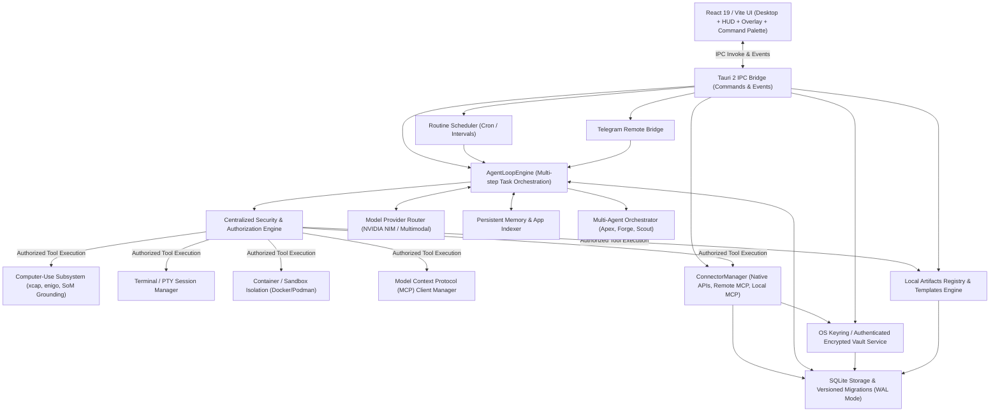

# Kyro Runtime Architecture Overview

## 1. System High-Level Topology

Kyro is a local-first, autonomous desktop agent application built on Tauri 2, featuring a React 19 + TypeScript frontend and a multi-threaded Rust backend (`libkyro`).

## 2. Component Inventory

### 2.1 Frontend Modules (`kyroui/`)
- `App.tsx`: Main workspace view displaying dual-mode experiences (Everyday vs Dev), conversation threads, live step timeline, tool execution cards, screen preview, model status, voice dictation, file attachments, and prompt dispatch.
- `hud/HudPanel.tsx`: Compact floating HUD window (`label: hud`) for autonomous task execution and quick snipping.
- `hud/Snipper.tsx`: Interactive screenshot region selector for visual grounding.
- `components/CommandPalette.tsx`: Global instant command palette (`Ctrl+K`) with multi-category universal search across conversations, messages, memories, skills, routines, and artifacts.
- `components/FileOrganizerModal.tsx`: Safe reversible file organizer UI with extension categorization, SHA-256 duplicate detection, operation plan preview, and one-click rollback.
- `components/DocumentAssistantModal.tsx`: Local-first document assistant with plain-text and PDF parser, date/action item extraction, side-by-side document diff comparison, and privacy disclosure.
- `components/ScreenExplainerModal.tsx`: Multimodal visual explainer modal with screenshot capture, structured facts vs inferred causes breakdown, and 1-click grounded action triggering.
- `components/DevWorkbenchModal.tsx`: Developer Workbench with 5 specialist tabs: Projects & Dev Servers, Code Checkpoints & Diffs, Build Doctor diagnostics, UI Audit & Visual Baselines, and Multi-Agent Workspace with isolated Git worktrees.
- `components/ArtifactsModal.tsx`: Local artifact registry drawer for previewing code, markdown, logs, json, and exporting generated files.
- `components/SettingsModal.tsx`: Configuration for NVIDIA API keys, Telegram credentials, governance matrix policy, model selections, extensible template packs, and system diagnostics.
- `components/ConnectionsModal.tsx`: Connections and app integrations modal: Discover Catalog, Connected Accounts, Custom Local MCP, and per-action governance policy manager.
- `components/TeammateRosterModal.tsx`: Agent team inspector (Apex, Forge, Scout) showing roles, capabilities, status, and task assignments.
- `components/TeachTaskModal.tsx`: Teach-a-Task recorder, skill catalog, and routine scheduler.
- `components/TimelineDrawer.tsx`: Historical timeline drawer visualizing step actions, coordinates, and pixel differences.
- `components/TerminalView.tsx`: Interactive xterm.js terminal connected to host PTY.
- `components/ToolCallCard.tsx`: Live card rendering tool calls, arguments, outputs, and status.
- `types/agent.ts`: Type definitions for domain entities, IPC payloads, and events.

### 2.2 Backend Modules (`libkyro/src/`)
- `main.rs`: Application entry point, config directory resolution, subsystem initialization, and Tauri command registration (69 registered commands).
- `commands.rs`: Typed Tauri IPC command handlers covering execution, governance, memory, artifacts, search, diagnostics, file organization, document analysis, vision explanation, code checkpoints, build doctor, visual baselines, and multi-agent workspace.
- `agent/`:
  - `loop_engine.rs`: Multi-step agent execution loop, tool definitions, tool dispatch, step events, per-run cancellation, artifact generation.
  - `router.rs`: Model client for NVIDIA NIM / OpenAI-compatible endpoints with capability registry, MIME/dimension validation, multimodal content parts, and exponential backoff retry.
  - `vision.rs`: Multimodal screenshot and visual defect analyzer with primary and fallback vision model resolution.
  - `cancellation.rs`: Scoped cancellation tokens with child run propagation.
- `governance/`:
  - `auth.rs`: Centralized `AuthorizationEngine` evaluating shell modes, computer use modes, blocked domains, path boundaries, credential checkpoints, and approval queues.
  - `policy.rs`: Policy engine (`GovernancePolicy`, blocked domains, shell modes).
  - `takeover.rs`: Sensitive checkpoint detection (2FA, CAPTCHA, passwords) and takeover status.
- `execution/`:
  - `permissions.rs`: Command risk assessment and permission gating.
  - `pty.rs`: Pseudo-terminal (PTY) spawn, resize, and I/O handling via `portable-pty`.
- `computer_use/`:
  - `capture.rs`: Screen and region screenshot capture using `xcap`.
  - `input.rs`: Mouse and keyboard synthesis via `enigo`.
  - `overlay.rs`: Coordinate transformation and multi-monitor scaling.
- `grounding/`:
  - `som.rs`: Set-of-Marks visual grounding engine, tag badge rendering, mark resolution.
- `ghost/`:
  - `display.rs`: Isolated virtual display (`:99`) control and application launch.
- `storage/`:
  - `db.rs`: SQLite database connection management, migrations (v1-v5), queries for conversations, messages, skills, routines, bots, MCP servers, runs, events, memories, timeline steps, artifacts, connector definitions, connected accounts, and connector tool policies.
  - `vault.rs`: Credential and API key management via OS Keyring and authenticated AES-256-GCM encrypted database fallback, with namespaced connector account secrets.
  - `organizer.rs`: Safe file organizer engine with extension rules, SHA-256 duplicate detection, destination collision handling, path containment verification, and manifest-backed reversible rollback.
  - `documents.rs`: Local document assistant engine for plain-text and PDF parsing, FlateDecode decompression, Tj/TJ text operator extraction, deterministic date & action item parsing, and document diffing.
  - `chunking.rs`: Format-aware chunking engine for Markdown (heading breadcrumbs + accurate line ranges), source code (symbol boundaries for functions, structs, classes), and plain text.
  - `retrieval.rs`: Deep Local RAG subsystem with hybrid BM25-style lexical scoring + cosine similarity semantic retrieval, loopback-only local embedding validation (`127.0.0.1`, `localhost`), and authorized folder query-time enforcement.
  - `templates.rs`: Extensible template packs, schema versioning, secret sanitization, and pre-packaged starters.
- `project/`:
  - `discovery.rs`: Dynamic project root resolution, candidate ranking, bounded search traversal, exclusion filters (`node_modules`, `.git`, `dist`, `build`, etc.), OS Desktop path resolution via `dirs::desktop_dir()`.
  - `devserver.rs`: Development server process lifecycle, ready line detection, port extraction, framework recognition.
  - `checkpoint.rs`: Git-aware reversible code checkpoints, uncommitted modification preservation, unified diff calculation, and conflict-checked safe rollback.
  - `doctor`: Automated Build Doctor parsing compiler errors (Rust `error[E...]`, TypeScript `error TS...`, Vitest test failures) and generating repair patches.
- `audit/`:
  - `workflow.rs`: Autonomous UI audit orchestrator: plan generation, server boot, multi-viewport responsive checks, route discovery, interaction exploration, finding aggregation, markdown report synthesis.
  - `regression.rs`: Visual regression baseline engine with persistent baseline registry in `~/.config/kyro/baselines/` and diff percentage calculations.
  - `routes.rs`: Static file and router config route extraction.
  - `findings.rs`: Categorized finding models (Bug, Accessibility, DesignInconsistency, Performance, Warning) and deduplication.
  - `report.rs`: Markdown report generator with summary metrics and reproducible evidence attachments.
- `multibot/`:
  - `bot.rs`: Bot profile definitions.
  - `group.rs`: Mention parsing and group system prompt generation.
  - `workspace.rs`: Multi-agent developer workspace with 5 specialist roles (`RepositoryInvestigator`, `ImplementationEngineer`, `TestRegressionSpecialist`, `CodeReviewer`, `DocumentationReviewer`), task dependency graph, isolated Git worktrees, and reviewed reconciliation.
- `teach_task/`:
  - `recorder.rs`: Task recording session manager with credential sanitization.
  - `replay.rs`: Deterministic workflow replayer with step progress reporting.
  - `scheduler.rs`: Routine background worker for cron/periodic execution.
  - `self_healing.rs`: Parameter substitution and coordinate recalibration.
  - `portable_routine.rs`: Portable routine serialization format `kyro.routine.v1` with secret redaction on export and untrusted capability validation on import.
  - `habit_learning.rs`: Local habit learning and automatic routine suggestion engine. Privacy-gated (disabled by default), sensitive-pattern filtering, deterministic action normalization, confidence scoring, and safe human-reviewed routine creation (`enabled = false`).
- `sandbox/`:
  - `docker.rs`: Container isolation detection, hardened arguments (`--read-only`, `--tmpfs`, `--cap-drop=ALL`, `pids-limit=100`), and allowlisted image validation.
  - `experiment.rs`: Sandboxed code-execution agents for safe experiments. Disposable workspace isolation, bounded stdout/stderr capture (64KB), cancellation token integration, automated artifact extraction, and experiment diff comparison.
- `connector/`:
  - `manager.rs`: `ConnectorManager` coordinating native adapters, remote HTTP MCP endpoints, local stdio MCP servers, OAuth lifecycle transitions, and per-action governance policy enforcement.
  - `auth.rs`: PKCE OAuth 2.0 flow coordinator with ephemeral loopback callback listener, single-flight token refresh, and Vault integration.
  - `native/github.rs`: Native GitHub adapter providing 11 repository, issue, PR, and GitHub Actions workflow inspection/management tools.
  - `native/google.rs`: Native Google adapter providing Gmail message/draft operations with RFC 2822 header injection protection & RFC 2047 MIME encoding, and Google Calendar timezone-correct availability analysis.
  - `remote_mcp.rs`: HTTP JSON-RPC 2.0 client supporting streamable MCP (`2026-07-28`) and legacy stateful (`2024-11-05`) protocols with SSRF protection.
- `telegram/`:
  - `bridge.rs`: Fail-closed remote mobile bridge with update polling, allowed chat ID gating, mobile approval resolution (`/approve <id>`, `/deny <id>`), desktop screenshot capture, and token sanitization.
- `browser/`:
  - `mod.rs`: `BrowserAutomationManager`, authoritative browser capability registry, browser preferences persistence in SQLite, session lifecycle and state tracking.
  - `worker.rs`: Subprocess lifecycle manager for `worker.mjs` over JSON-lines stdio protocol.
  - `safety.rs`: Navigation safety policy, origin scope confinement, blocked domain enforcement.
  - `types.rs`: Semantic locators, element targets, page snapshots, observation payloads.
  - `worker.mjs`: Provider-neutral browser worker supporting Firefox family (via native WebDriver BiDi) and Chromium family (Google Chrome, Chromium, Microsoft Edge, Brave, Vivaldi, Opera via Chrome DevTools Protocol over WebSocket) using Node 20+ built-ins.

---

## 3. Runtime Lifecycle & Dataflow

1. **User Action / Trigger**: Initiated via Desktop Chat UI, Floating HUD, Scheduled Routine, Global Command Palette (`Ctrl+K`), Voice Dictation, or Telegram command.
2. **Task Ingestion & Run Creation**: A unique run ID is assigned to an `AgentRun` entity, recording task input, executing agent profile, conversation reference, and model choice.
3. **Context Compilation**:
   - Relevant conversation messages retrieved.
   - Distinct-scope persistent memories injected (preferences, workspace facts, applications).
   - Agent team system prompt synthesized according to role.
4. **Model Iteration**:
   - Model router calls provider with chat history and tool definitions.
   - When vision is active, validated screenshots are encoded into `MessageContent::Parts` and attached to provider messages.
   - Provider returns thought content and tool calls.
5. **Centralized Authorization**:
   - Every tool call (shell, filesystem, computer action, MCP, skill, artifact) is converted into an `ExecutionRequest`.
   - The centralized policy engine evaluates shell mode, computer use mode, blocked domains, path boundaries, and credential sensitivity.
   - Actions requiring human confirmation generate persisted `ApprovalRequest` items.
6. **Tool Execution, Grounding & Artifact Registration**:
   - Authorized actions run within host, PTY, or sandbox.
   - Visual actions leverage Set-of-Marks grounding and post-action verification.
   - Generated files are registered in the durable `artifacts` database table.
   - Timeline engine records before-and-after visual diffs and target markers.
7. **Event Timeline & Persistence**:
   - Monotonic sequence numbers order all run events.
   - Tool outputs and assistant responses are persisted transactionally to SQLite in WAL mode.
8. **Completion**: Terminal states (`succeeded`, `failed`, `cancelled`, `interrupted`) are recorded, desktop notifications dispatched, and results reflected in UI.
